# Mapa del proceso de apartado · DOC-03

El primer mapa representa el trabajo manual descrito en el enunciado (libreta, Excel y calculadora); no es una observación de una tienda real. El segundo muestra la app y las automatizaciones del equipo. Un detalle separado permite seguir los pagos a distancia sin perder de vista los controles.

**Referencia:** `dev` en `ff58b7e`, 28/10/2026; PF-03 en la [PR #36](https://github.com/IA-P1-BCN/LUSOGIRLS-N8N/pull/36), commit `efe35cf`, todavía pendiente de aprobación e integración. El mapa describe el comportamiento implementado/probado en laboratorio, no una publicación en producción. HU-13, HU-14 y HU-16 no se representan como terminadas.

## 1. Antes: libreta, Excel y calculadora



[Imagen SVG](diagramas/apartado-manual.svg) · [PDF](diagramas/apartado-manual.pdf) · [Fuente editable Mermaid](diagramas/apartado-manual.mmd)

La dependienta y Marisa identifican los pagos, actualizan el saldo y detectan vencimientos manualmente. Los recordatorios dependen de la memoria; el cierre diario y el mensual requieren copiar movimientos al Excel y sumar. El diagrama expresa las reglas del negocio que deben respetarse, no garantiza que el proceso manual esté libre de errores.

## 2. Después: app, API y n8n



[Imagen SVG](diagramas/apartado-automatizado.svg) · [PDF](diagramas/apartado-automatizado.pdf) · [Fuente editable Mermaid](diagramas/apartado-automatizado.mmd)

**Leyenda:** amarillo = actuación humana; azul = escritura/estado en la app; verde = automatización o aviso; rombo = decisión. El recuadro discontinuo de PF-03 indica revisión pendiente. Las flechas discontinuas conectan tareas periódicas o controles comunes, no son nuevos eventos HTTP.

| Paso | Responsable y contrato comprobable |
| --- | --- |
| Alta | Dependienta usa la app; `POST /api/apartados` crea apartado y abono inicial. Precio positivo; `5 <= abono_inicial <= precio`; límite = fecha + 90 días. |
| Confirmación | Solo se emite `apartado.creado` por el alta, aunque ya exista el abono inicial. PF-00 lo dirige a PF-01. |
| Abonos posteriores | API valida importe positivo, saldo, estado y plazo. No hay mínimo de 5 EUR para abonos posteriores. Al llegar a cero pasa a `liquidado`. |
| Recibo | Evento `abono.registrado` → PF-00 → PF-02. El mensaje usa los importes de la API; si queda liquidado indica que se pueden recoger los zapatos. |
| Recordatorios | PF-06 consulta activos cada mañana y avisa cuando faltan exactamente 7 o 1 días; reserva persistente para evitar repetir el mismo hito. |
| Vencimiento | Solo si el límite es anterior a hoy. La API no vence por el mero paso del tiempo: PF-06 solicita `POST /api/apartados/{id}/vencer` y relee el estado. La API genera el vale por lo abonado. |
| Aviso del vale | PF-06 recibe `apartado.vencido` desde PF-00 y concilia vales recientes. Evento y calendario usan las mismas claves de aviso; no deben duplicarlo. |
| Entrega o liberación física | La tienda entrega el par liquidado o devuelve al escaparate el vencido. No hay catálogo ni inventario que n8n pueda actualizar. No se devuelve el dinero en efectivo. |
| Cierre e informe | PF-05 y PF-07 consultan ventas y abonos por API. Incluyen los abonos iniciales; no suman otra vez el precio de los apartados ni el importe de los vales. |
| Errores y correo ausente | Aviso a Marisa. PF-08 recibe errores técnicos y limita la información del aviso para no exponer secretos. |

Un saldo cero también puede darse en el alta: no hace falta esperar un segundo abono para liquidar. Pagar el día límite está permitido; vencer ese mismo día, no. Las fechas de negocio se interpretan en `Europe/Madrid`.

## 3. Detalle de PF-03: un correo no autoriza un cobro



[Imagen SVG](diagramas/abono-distancia.svg) · [PDF](diagramas/abono-distancia.pdf) · [Fuente editable Mermaid](diagramas/abono-distancia.mmd)

La IA extrae datos; la API y el código del flujo deciden si el pago puede registrarse. Publicidad, cliente desconocido, identidad ambigua, exceso de importe y apartado fuera de plazo no producen un abono automático. Un resultado incierto de un POST no permite repetir el cobro a ciegas.

El enunciado y la daily hablan de ocho correos, pero la carpeta contiene **nueve**. La prueba de PF-03 del 28/10 cubre los nueve y una repetición: 10/10 casos, ejecuciones 362–389. [Evidencia en el commit revisable](https://github.com/IA-P1-BCN/LUSOGIRLS-N8N/blob/efe35cfd5d41f06ba5cfcabec174df8968d42f5f/docs/pruebas/03-abonos-distancia.md). Esto no sustituye una comparativa controlada entre dos modelos.

## Alcance, fuentes y mantenimiento

El webhook de la versión representada todavía no exige autenticación; tampoco hay consentimiento de notificaciones almacenado en la app. Son pendientes de HU-14, no capacidades acreditadas por este mapa. La app no reintenta los webhooks perdidos. Los avisos locales usan datos ficticios y Mailpit; credenciales y destinos de producción requieren configuración.

- [Enunciado y reglas](../README.md), [ontología](ontologia.md) y [guía de la app](guia-de-la-app.md).
- Contratos: [controlador de apartados](../backend/controllers/apartados.py), [modelo de apartados](../backend/models/apartado.py), [modelo de abonos](../backend/models/abono.py) y [emisor de eventos](../backend/services/n8n.py).
- Flujos: [PF-00](../specs/00-entrada-eventos.md), [PF-01](../specs/01-confirmacion-apartado.md), [PF-02](../specs/02-recibo-abono.md), [PF-06](../specs/06-recordatorios-vencimientos.md), [PF-05](../specs/05-cierre-diario.md), [PF-07](../specs/07-informe-mensual.md) y [PF-08](../specs/08-errores.md).

Los mapas se mantienen en Mermaid, una herramienta de diagramas de flujo con texto editable. SVG y PDF se exportan de las mismas fuentes. Para regenerar cada mapa desde la raíz del repositorio, sustituir `apartado-manual` por el nombre correspondiente:

```bash
npm exec --yes --package @mermaid-js/mermaid-cli@11.12.0 -- mmdc -i docs/diagramas/apartado-manual.mmd -o docs/diagramas/apartado-manual.svg -c docs/diagramas/mermaid-config.json -b white
npm exec --yes --package @mermaid-js/mermaid-cli@11.12.0 -- mmdc -i docs/diagramas/apartado-manual.mmd -o docs/diagramas/apartado-manual.pdf -c docs/diagramas/mermaid-config.json -b white --pdfFit
```

Mermaid CLI utiliza un navegador Chromium. Si no está descargado, se puede utilizar un Chrome instalado mediante `-p /ruta/config-navegador.json`, con `{"executablePath":"/ruta/al/ejecutable-de-Chrome"}`. Ese archivo es local y no forma parte de la entrega.

La fuente editable permite revisar cada decisión sin depender de una cuenta de Miro. Esta documentación no modifica workflows ni atribuye una aprobación a Rita: la revisión de DOC-03 se registra en su PR.
