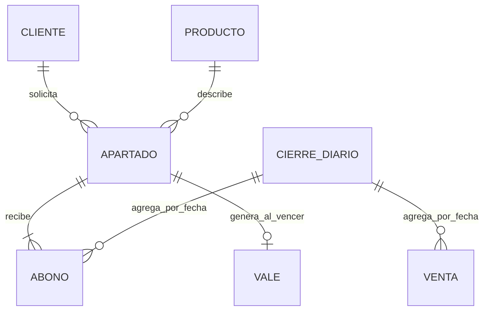

# Ontología de Paso Firme

Fuente de verdad: [esquema SQLite](../backend/database.py), [modelos](../backend/models/apartado.py), [schemas](../backend/schemas/apartado.py) y [guía de la app](guia-de-la-app.md). Esta ontología describe el dominio; no crea tablas ni endpoints nuevos.

## Entidades y representación

| Entidad | Atributos | Identidad y representación actual |
| --- | --- | --- |
| Cliente | nombre, teléfono, email | Concepto del negocio. La app guarda `cliente`, `telefono`, `email` dentro de cada apartado; no existe `cliente_id` ni `/api/clientes`. Un nombre no identifica de forma fiable a una persona. |
| Producto | modelo, talla, precio | Concepto del negocio. Se guarda como `producto`, `talla`, `precio` en el apartado; no hay catálogo, stock ni `producto_id` en la API. |
| Apartado | `id`, `fecha`, `cliente`, `telefono`, `email`, `producto`, `talla`, `precio`, `fecha_limite`, `estado`, `abonado`, `pendiente`, `consentimiento_notificaciones`, `consentimiento_actualizado` | Tabla `apartados`. La API calcula `abonado` y `pendiente` a partir de los abonos. |
| Abono | `id`, `apartado_id`, `fecha`, `importe`, `forma_pago` | Tabla `abonos`. Incluye el pago inicial. Cada abono pertenece a un único apartado. |
| Venta | `id`, `fecha`, `concepto`, `importe`, `forma_pago` | Tabla `ventas`: venta directa, independiente de los abonos. Liquidar un apartado no crea una venta aquí. |
| Vale | `id`, `codigo`, `apartado_id`, `fecha`, `importe`, `usado` | Tabla `vales`. Nace al vencer un apartado; código `VALE-<id con cinco dígitos>`. No hay endpoint para canjearlo. |
| CierreDiario | fecha, ventas, abonos, total y desglose por medio | Resultado de n8n. La API no guarda cierres; elegir almacenamiento auxiliar con clave única por fecha. |
| InformeMensual | período, recaudación, pendiente, nuevos, liquidados, vencidos | Resultado de n8n, no una tabla de la app. Declarar cuándo se mide el pendiente. |
| Notificación | tipo, destinatario, referencia, resultado del envío | Registro auxiliar propuesto para deduplicación; no existe en la API. Evitar guardar el mensaje completo si no es necesario. |
| PagoDetectado | identificador del correo, ordenante, importe, concepto, medio, candidato | Dato de trabajo del flujo 03. Solo un pago validado se convierte en Abono mediante la API. |
| CobroDatafono | terminal, operación estable, fecha, concepto, importe en céntimos, vínculo opcional a Venta | Dato de intercambio de [PF-12](../specs/12-ventas-datafono.md). Reserva `datafono:<terminal>:<operacion>` en PostgreSQL auxiliar. Las nuevas ventas incluyen la referencia en `concepto`; no existe un campo dedicado ni otro endpoint en la app. |

`telefono`, `email` y `talla` pueden ser nulos. Fechas: `YYYY-MM-DD`; importes: EUR. Las fechas de la app no incluyen hora. `estado` solo admite `activo`, `liquidado`, `vencido`; `usado` del vale es un entero.

## Relaciones

Las relaciones con Cliente, Producto y CierreDiario son conceptuales. No implican claves foráneas ni tablas disponibles en la app.

## Invariantes

1. Precio positivo; `5 <= abono_inicial <= precio`.
2. `fecha_limite = fecha + 90 días`. Se admite pagar el mismo día del límite; vencer exige que hoy sea posterior.
3. Abonos posteriores: `0 < importe <= pendiente`, estado activo y fecha del pago dentro del plazo. `fecha` explícita se reserva para migración, no para esquivar un vencimiento en un pago nuevo.
4. `abonado` es la suma de abonos y `pendiente = precio - abonado`, calculados por la app. Los flujos consumen estos valores.
5. El saldo cero produce `liquidado`. Pasar la fecha no cambia automáticamente el estado: n8n solicita el vencimiento por API.
6. Vencer genera un vale por `abonado`; no un nuevo ingreso ni una devolución. El aviso de liberar zapatos no actualiza ningún inventario, porque la app no lo tiene.
7. Recaudación diaria/mensual: sumar ventas directas y abonos del período, una sola vez cada registro. No sumar el precio total de los apartados.
8. Pendiente actual: sumar `pendiente` de apartados cuyo estado sigue siendo `activo`, incluidos los fuera de plazo aún no vencidos por API.

## Eventos y salidas de la API

Con Header Auth `X-PF-Webhook-Key` (HU-14), la app envía `{"evento": "...", "datos": {...}}`. En la salida del nodo Webhook se encuentra bajo `body`.

| Evento | Contenido de `datos` | Ruta en n8n |
| --- | --- | --- |
| `apartado.creado` | Apartado con estado y saldos | `$json.body.datos.id` |
| `abono.registrado` | Apartado actualizado más `importe` del pago | `datos.id` es el ID del apartado, **no** el del abono. |
| `venta.registrada` | Venta | `$json.body.datos.importe` |
| `apartado.vencido` | `{apartado, vale}` | `$json.body.datos.apartado.estado` y `$json.body.datos.vale` |

Crear un apartado inserta el abono inicial, pero solo emite `apartado.creado`. El flujo 01 cubre esa confirmación; no se debe esperar otro evento de abono inicial.

## Límites que afectan al diseño

- No hay ID único de evento, reintentos del emisor ni entrega garantizada. Los cierres consultan la API aunque no lleguen webhooks.
- No hay clave de idempotencia en los POST. El flujo necesita un registro auxiliar y una estrategia de conciliación ante resultados inciertos.
- No hay `fecha_liquidacion`: para el informe mensual se deriva de los abonos del apartado liquidado. El vencimiento usa la fecha del vale.
- HU-14 registra consentimiento de correo por apartado: booleano explícito, false por defecto, con fecha UTC del último cambio. `GET/PATCH /api/apartados/{id}/consentimiento` requieren la clave API. No hay identidad de Telegram ni permiso para ese canal: nunca inferirlos del email, nombre o permiso de correo.
- `transferencia` se añade a `FORMAS_PAGO` de [config.py](../backend/config.py) por autorización de Fabiana el 22/10/2026. Se conserva como medio propio, incluidos los desgloses; no modifica los pagos históricos.
